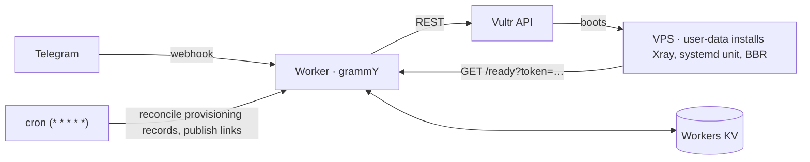

# telegram-vpn-bot

[](https://opensource.org/licenses/MIT)

Serverless Telegram bot that provisions and destroys **VLESS + REALITY** proxy
servers on Vultr. Runs entirely on Cloudflare Workers: webhook in, Vultr API
out, fresh credentials per server, no always-on process to babysit.

## What it does

- `/up`: choose a region (Seoul / Tokyo / Singapore). The bot creates a Vultr
  instance, waits for it to bootstrap Xray, then posts an importable
  `vless://` link and a QR code.
- `/down`: destroy a tracked instance (two-step confirmation).
- `/status`: tracked servers with age and live power state.
- `/id`: print your Telegram id (setup helper).

Every server gets a new X25519 key pair, UUID and short id, generated with
WebCrypto inside the worker. Workers KV holds the registry; each share link is
a bearer credential, so treat it as a secret.

## Architecture



State lives in Workers KV (`inst:<id>`, `secret:<token>`). A cloud-init script
calls `/ready` with a per-instance token, and cron reconciles when that callback
is lost. Eight minutes after create, a running instance is published with its
Vultr IP and a warning. Provisioning records fail after 15 minutes.

## Documentation

Extended docs live in [`docs/`](docs/home.md) and mirror the
[GitHub wiki](https://github.com/notlega/telegram-vpn-bot/wiki):

| Page                                 | Contents                                                |
| ------------------------------------ | ------------------------------------------------------- |
| [Architecture](docs/architecture.md) | request flow, KV schema, reconciliation, security model |
| [Deployment](docs/deployment.md)     | zero → live runbook                                     |
| [Clients](docs/clients.md)           | importing links into v2rayN / v2rayNG                   |
| [Operations](docs/operations.md)     | IP-burn lifecycle, cost, troubleshooting                |

## Setup

### 1. Prerequisites

- Cloudflare account (free plan is enough)
- Vultr account + API token (Account → API, enable IPv4 + instances read/write)
- Telegram bot token from [@BotFather](https://t.me/BotFather)
- Your Telegram user id from [@userinfobot](https://t.me/userinfobot)

### 2. Local tooling

Requires [bun](https://bun.sh) 1.2+. Wrangler is a project devDependency, so
`bun install` pins the CLI to this checkout.

```sh
bun --version
bun install
bunx wrangler login
```

### 3. Create the KV namespace

```sh
bunx wrangler kv namespace create KV
```

Copy the printed `id` into `wrangler.toml` (`REPLACE_WITH_KV_NAMESPACE_ID`).

### 4. Secrets

Copy `.env.example` to `.env` and update the values within.
`bun run secrets` pushes them to the worker's encrypted secrets.

```sh
cp .env.example .env
bun run secrets
```

Bun loads `.env` automatically, so the helper scripts need no extra setup.
`WEBHOOK_SECRET` is any random string; the worker rejects webhook calls without
it.

### 5. Deploy and register the webhook

Replace `<workers-url>` with your deployment URL, e.g.
`https://telegram-vpn-bot.<subdomain>.workers.dev`.

```sh
bun run deploy
bun run set-webhook -- <workers-url>
```

### 6. Use it

Open the bot, `/id` to double check the allowlist, then `/up`.

## Configuration

`wrangler.toml`:

| Var       | Meaning                                                                          |
| --------- | -------------------------------------------------------------------------------- |
| `REGIONS` | `id:label` pairs offered in the `/up` menu (`icn:Seoul,nrt:Tokyo,sgp:Singapore`) |
| `PLAN`    | Vultr plan id, default `vc2-1c-1g` without backups enabled (~$5/mo)              |
| `OS_NAME` | OS family prefix to resolve dynamically, default `Debian`                        |
| `SNI`     | REALITY camouflage destination, default `www.yahoo.com`                          |

`OS_NAME` defaults to Debian because the bootstrap script needs cloud-init for
user-data; Vultr's Alpine images do not ship it.

## Security notes

- Allowlist enforced on every update (`ALLOWED_USER_ID`, comma separated).
  unauthorized senders get no reply; the second message within an hour blocks
  them for a day via a durable object gatekeeper
- Telegram webhook requires `X-Telegram-Bot-Api-Secret-Token`
- Destroy always requires an inline confirmation
- Credentials are generated per instance and never written to the repository.
  The bot installs no SSH key, so a provisioned box has no remote shell.
- Links are single-server secrets: anyone with the link can use the proxy

## Limits

- One Vultr account token, no multi-tenant support
- No automatic GFW/IP-burn detection; `/status` shows state and humans decide
- Provisioning assumes Vultr's Debian images and user-data support
- `vc2-1c-1g` availability varies per region; a Vultr 4xx will be reported in chat

## Development

```sh
bun run dev     # wrangler dev, local worker + local KV
bun run check   # typecheck + biome
bun run lint    # biome check
bun run format  # biome format --write
curl http://127.0.0.1:8787/
```

Local callback test:

```sh
bunx wrangler kv key put --binding KV --local "secret:testtoken" "<instance-id>"
bunx wrangler kv key put --binding KV --local "inst:<instance-id>" '<record-json>'
curl "http://127.0.0.1:8787/ready?token=testtoken&ip=203.0.113.10"
```

`wrangler dev` loads `.env` automatically (add `--env-file path` for another
file).

## Contributing

see [CONTRIBUTING.md](CONTRIBUTING.md) for the local setup, code style and commit
conventions.

checks are manual, there is no ci workflow. run `bun run check` before pushing.

## License

[MIT](LICENSE) © 2026 Ong Hin Journ
