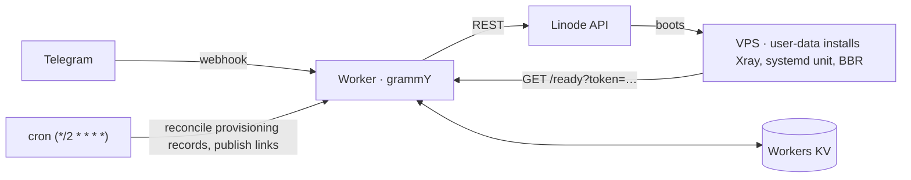

# telegram-vpn-bot

[](https://opensource.org/licenses/MIT)

Serverless Telegram bot that provisions and destroys **VLESS + REALITY** proxy
servers on Linode. Runs entirely on Cloudflare Workers: webhook in, Linode API
out, fresh credentials per server, no always-on process to babysit.

## What it does

- `/create`: choose a region (Tokyo / Osaka / Singapore). The bot creates a
  linode instance, waits for it to bootstrap Xray, then posts an importable
  `vless://` link and a QR code.
- `/restart`: reboots a server. disk, ip and credentials stay, and
  the link keeps working after reboot.
- `/destroy`: destroy a tracked instance for good (two-step confirmation).
- `/status`: tracked servers with age and live power state.
- `/id`: print your Telegram id (setup helper).

Commands are slash-only: the bot registers no text matchers, so plain chat text
never reaches a handler.

Every server gets a new X25519 key pair, UUID and short id, generated with
WebCrypto inside the worker. Workers KV holds the registry; each share link is
a bearer credential, so treat it as a secret.

## Architecture



State lives in Workers KV (`inst:<id>`, `secret:<token>`, plus a `pending` index
and a short-lived image cache). A cloud-init script calls `/ready` with a
per-instance token, and cron reconciles when that callback is lost. Eight
minutes after create, a running instance is published with its linode ip and a
warning. Provisioning records fail after 15 minutes. `/restart` restarts the instance;
`/destroy` removes it.

## Documentation

Extended docs live in [`docs/`](docs/home.md) and mirror the
[GitHub wiki](https://github.com/notlega/telegram-vpn-bot/wiki):

| Page                                 | Contents                                                |
| ------------------------------------ | ------------------------------------------------------- |
| [Architecture](docs/architecture.md) | request flow, KV schema, reconciliation, security model |
| [Deployment](docs/deployment.md)     | zero → live runbook                                     |
| [Clients](docs/clients.md)           | importing links into v2rayN / v2rayNG                   |
| [Operations](docs/operations.md)     | IP-burn lifecycle, cost, troubleshooting                |

## Setup

### 1. Prerequisites

- Cloudflare account (free plan is enough)
- Linode account + api token (cloud.linode.com → profile → api tokens)
- Telegram bot token from [@BotFather](https://t.me/BotFather)
- Optional: your Telegram user id from [@userinfobot](https://t.me/userinfobot), for
  access control

### 2. Local tooling

Requires [bun](https://bun.sh) 1.2+. Wrangler is a project devDependency, so
`bun install` pins the CLI to this checkout.

```sh
bun --version
bun install
bunx wrangler login
```

### 3. Create the KV namespace

```sh
cp wrangler.toml.example wrangler.toml
bunx wrangler kv namespace create KV
```

Copy the printed `id` into `wrangler.toml`. The binding name stays `KV`; the code
and local test commands reference it.

### 4. Secrets

Copy `.env.example` to `.env` and update the values within.
`bun run secrets` pushes them to the worker's encrypted secrets.

```sh
cp .env.example .env
bun run secrets
```

Bun loads `.env` automatically, so the helper scripts need no extra setup.
`WEBHOOK_SECRET` is any random string; the worker rejects webhook calls without
it.

### 5. Deploy and register the webhook

Replace `<workers-url>` with your deployment URL, e.g.
`https://telegram-vpn-bot.<subdomain>.workers.dev`.

```sh
bun run deploy
bun run set-webhook -- <workers-url>
```

### 6. Use it

Open the bot, `/id` to double check the allowlist, then `/create`.

## Configuration

`wrangler.toml`:

| Var       | Meaning                                                                        |
| --------- | ------------------------------------------------------------------------------ |
| `REGIONS` | `id:label` pairs offered in the `/create` menu (`jp-tyo-3:Tokyo,jp-osa:Osaka`) |
| `TYPE`    | linode plan id, default `g6-nanode-1` (~$5/mo)                                 |
| `IMAGE`   | linode image id, must support cloud-init, default `linode/debian13`            |
| `SNI`     | REALITY camouflage destination, default `www.yahoo.com`                        |

`IMAGE` must support cloud-init, otherwise the bootstrap user data never runs.
the bot checks the image capabilities and refuses images without it, which rules
out Alpine until you build a cloud-init-ready golden image.

## Security notes

- Access control is opt-in. set `ALLOWED_USER_ID` (comma separated) to restrict
  the bot; leave it empty for an open bot. when restricted, unauthorized senders
  get no reply and the second message within an hour is blocked for a day via a
  durable object gatekeeper
- Telegram webhook requires `X-Telegram-Bot-Api-Secret-Token`
- Destroy always requires an inline confirmation
- Credentials are generated per instance and never written to the repository.
  The bot installs no SSH key, so a provisioned box has no remote shell.
- Links are single-server secrets: anyone with the link can use the proxy

## Limits

- One linode account token, no multi-tenant support
- No automatic GFW/IP-burn detection; `/status` shows state and humans decide
- Provisioning assumes a cloud-init capable linode image
- `g6-nanode-1` availability varies per region; a linode 4xx will be reported in chat

## Development

`bun run dev` starts the local worker with local KV. `bun run check` runs the
typecheck and biome, `bun run lint` runs biome alone, `bun run format` rewrites
formatting.

```sh
bun run dev
bun run check
bun run lint
bun run format
```

Health check once the worker is up:

```sh
curl http://127.0.0.1:8787/
```

Local callback test:

```sh
bunx wrangler kv key put --binding KV --local "secret:testtoken" "<instance-id>"
bunx wrangler kv key put --binding KV --local "inst:<instance-id>" '<record-json>'
curl "http://127.0.0.1:8787/ready?token=testtoken&ip=203.0.113.10"
```

`wrangler dev` loads `.env` automatically (add `--env-file path` for another
file).

## Contributing

see [CONTRIBUTING.md](CONTRIBUTING.md) for the local setup, code style and commit
conventions.

checks are manual, there is no ci workflow. run `bun run check` before pushing.

## License

[MIT](LICENSE) © 2026 Ong Hin Journ
