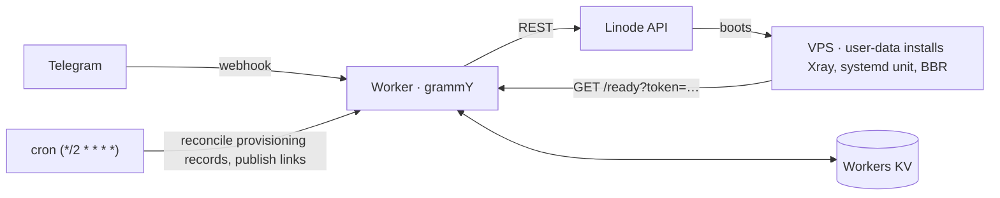

# Architecture

## Request flow



The worker has three HTTP routes:

| Route            | Purpose                                                        |
| ---------------- | -------------------------------------------------------------- |
| `POST /telegram` | Telegram webhook, guarded by `X-Telegram-Bot-Api-Secret-Token` |
| `GET /ready`     | cloud-init completion callback (`token` + `ip` query params)   |
| `GET /`          | health check string                                            |

Plus one scheduled handler, `reconcile`, bound to a two-minute cron trigger.

## Provisioning lifecycle

1. **`/create` pressed.** The worker confirms the configured image supports
   cloud-init (`IMAGE`), generates
   credentials, and builds two artifacts:
   - the Xray server config (REALITY inbound on `:443`, VLESS + Vision)
   - a bootstrap shell script containing that config, a systemd unit, BBR
     sysctls and a callback `curl`
2. **Instance created.** `POST /v2/instances` carries the bootstrap script as
   base64 `user_data`. The registration is stored in KV as `state=provisioning`
   together with a one-time `secret`, and the id joins the `pending` index.
3. **Bootstrap.** The fresh Debian box installs `curl`/`unzip`, downloads the
   latest Xray release, starts the service, enables BBR, then calls
   `GET /ready?token=<secret>&ip=<public ip>` up to six times.
4. **Ready.** The worker resolves the record from `secret:<token>`, stores the
   reported IP, flips the state to `ready`, edits the original chat message with
   the `vless://` link and sends a QR PNG. the token index is deleted on that
   save, so the callback works once.
5. **Restart, cleanup.** `/restart` → `POST /v2/instances/<id>/reboot`, the
   record stays `ready` and gains a `rebootedAt` timestamp. `/destroy` →
   confirmation → `DELETE /v2/instances/<id>`, every KV key for the record
   removed.

### Restart

`/restart` reboots a running instance in place, by ip argument or button prompt.
The disk, ip and credentials are untouched, so the `vless://` link keeps working
once Xray comes back through its enabled systemd unit.

linode accepts the reboot request before the server is actually back, so the bot
tracks completion: the record carries `rebootedAt` while a reboot is in flight,
the cron sweep confirms the chat message (`✅ … restarted in 42 s`) once linode
reports `running` again — with a 30 second grace so the stale pre-reboot
`running` status cannot count — and warns if nothing confirms within 10 minutes.

There is no pause command. Linode bills a powered-off instance the same as a
running one, so pausing saved nothing and only added a state to track. Only
`/destroy` stops the invoice.

### Reconciliation fallbacks

| Situation                        | Behaviour                                                                   |
| -------------------------------- | --------------------------------------------------------------------------- |
| Callback arrives                 | immediate publish (normal path)                                             |
| Callback lost, instance running  | cron publishes after **8 minutes** using the linode ip, with a warning note |
| Instance vanished from Linode    | cron marks `failed` on the next tick                                        |
| No callback after **15 minutes** | cron marks `failed`                                                         |

Cron reads the `pending` index first, so a quiet fleet costs one KV read per
tick instead of a full registry list.

## KV schema

Four keys:

```
inst:<instance-id>        -> InstanceRecord JSON
secret:<callback-token>   -> "<instance-id>"   (only while provisioning)
pending                   -> ["<id>", …]        (ids still provisioning)
cache:images              -> image catalogue    (24 h ttl)
```

`InstanceRecord`:

| Field                                               | Meaning                                   |
| --------------------------------------------------- | ----------------------------------------- |
| `id`                                                | linode instance id                        |
| `region`, `regionLabel`                             | `jp-tyo-3` / Tokyo etc.                   |
| `ip`                                                | reported by callback (or linode fallback) |
| `state`                                             | `provisioning` \| `ready` \| `failed`     |
| `chatId`, `messageId`                               | where the status message lives            |
| `secret`                                            | one-time callback token                   |
| `uuid`, `privateKey`, `publicKey`, `shortId`, `sni` | Xray credentials                          |
| `createdAt`, `readyAt`, `rebootedAt`, `error`       | bookkeeping                               |

The `secret` index exists so the callback can authenticate without exposing the
instance id. It is written only while a record is provisioning and deleted on
every later save, so a token cannot be replayed. `cache:images` spares a
500-entry Linode image fetch on every `/create`; the catalogue changes rarely,
so a day of staleness is acceptable.

## Credential generation

- X25519 key pair via `crypto.subtle.generateKey`, exported as raw bytes
  (PKCS#8 fallback for the private key) with base64url encoding, which is the
  format Xray's `x25519` command emits. Verified: derived public key equals
  exported public key.
- UUID from `crypto.randomUUID()`.
- Short id from 4 random bytes, hex.
- Callback secret from 24 random bytes, hex.

Nothing is reused between servers: a burned server never leaves reusable
credentials behind.

## Server-side layout (provisioned box)

| Path                               | Contents                                            |
| ---------------------------------- | --------------------------------------------------- |
| `/usr/local/bin/xray`              | Xray binary + geo assets                            |
| `/usr/local/etc/xray/config.json`  | REALITY inbound config                              |
| `/etc/systemd/system/xray.service` | systemd unit (`XRAY_LOCATION_ASSET=/usr/local/bin`) |
| `/etc/sysctl.d/99-bbr.conf`        | BBR + fq                                            |
| `/var/log/vpn-setup.log`           | bootstrap transcript                                |

No SSH key is installed and port 22 is not managed by the bot, so the instance
is intentionally not remotely administrable by default.

## Security model

- Access control is telegram's job. restrict who can message the bot in the
  botfather miniapp (bot settings → access settings): restricted bots accept
  only the owner plus up to 10 added users, and rejected users can't even open
  the bot, so no update ever reaches the webhook. the setting is gui-only —
  there is no api to change it.
- Telegram sends `X-Telegram-Bot-Api-Secret-Token`; the worker rejects
  mismatches.
- Every command is registered through `bot.command` and replies through callback
  queries; there are no text matchers, so a chat message can never trigger a
  server action.
- Callback tokens are 48 hex characters, random per instance, and accepted once:
  the KV index entry disappears as soon as the record leaves `provisioning`.
- Destroy asks for inline confirmation. There is no `/destroy all` shortcut.
- A `vless://` link is a bearer credential: whoever holds it can use the proxy.
  `/restart` keeps that link valid.

## Failure modes

| Symptom                           | Likely cause                                | Fix                                                  |
| --------------------------------- | ------------------------------------------- | ---------------------------------------------------- |
| linode 401/403 on `/create`       | api token scopes / account limit            | Re-issue token with read/write scopes                |
| 4xx "type not available"          | `TYPE` not offered in that region           | Change `TYPE` in `wrangler.toml`                     |
| No callback, failure after 15 min | Bootstrap script aborted                    | linode lish console → view `/var/log/vpn-setup.log`  |
| Link answers but no traffic       | REALITY SNI blocked or IP burned            | `/create` a new region, destroy old                  |
| `webhook` returns 403             | `WEBHOOK_SECRET` mismatch with `setWebhook` | Re-run `scripts/set-webhook.ts` with the same secret |
