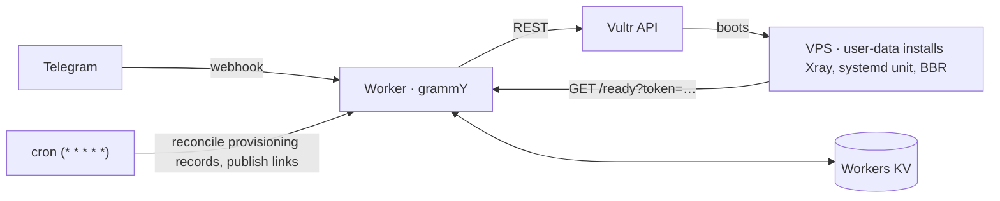

# Architecture

## Request flow



The worker has three HTTP routes:

| Route            | Purpose                                                        |
| ---------------- | -------------------------------------------------------------- |
| `POST /telegram` | Telegram webhook, guarded by `X-Telegram-Bot-Api-Secret-Token` |
| `GET /ready`     | Cloud-init completion callback (`token` + `ip` query params)   |
| `GET /`          | Health check string                                            |

Plus one scheduled handler, `reconcile`, bound to a one-minute cron trigger.

## Provisioning lifecycle

1. **`/up` pressed.** The worker resolves the OS image and plan from the Vultr API
   (`OS_NAME` prefix match on x64 images, `PLAN` id match), generates
   credentials, and builds two artifacts:
   - the Xray server config (REALITY inbound on `:443`, VLESS + Vision)
   - a bootstrap shell script containing that config, a systemd unit, BBR
     sysctls and a callback `curl`
2. **Instance created.** `POST /v2/instances` carries the bootstrap script as
   base64 `user_data`. The registration is stored in KV as `state=provisioning`
   together with a one-time `secret`.
3. **Bootstrap.** The fresh Debian box installs `curl`/`unzip`, downloads the
   latest Xray release, starts the service, enables BBR, then calls
   `GET /ready?token=<secret>&ip=<public ip>` up to six times.
4. **Ready.** The worker resolves the record from `secret:<token>`, stores the
   reported IP, flips the state to `ready`, edits the original chat message with
   the `vless://` link and sends a QR PNG.
5. **Cleanup.** `/down` → confirmation → `DELETE /v2/instances/<id>`,
   both KV keys removed.

### Reconciliation fallbacks

| Situation                        | Behaviour                                                                  |
| -------------------------------- | -------------------------------------------------------------------------- |
| Callback arrives                 | immediate publish (normal path)                                            |
| Callback lost, instance running  | cron publishes after **8 minutes** using the Vultr IP, with a warning note |
| Instance vanished from Vultr     | cron marks `failed` on the next tick                                       |
| No callback after **15 minutes** | cron marks `failed`                                                        |

Cron only touches records in `provisioning`, so a quiet fleet costs nothing.

## KV schema

Two key families:

```
inst:<vultr-instance-id>  -> InstanceRecord JSON
secret:<callback-token>   -> "<vultr-instance-id>"
```

`InstanceRecord`:

| Field                                               | Meaning                                  |
| --------------------------------------------------- | ---------------------------------------- |
| `id`                                                | Vultr instance id                        |
| `region`, `regionLabel`                             | `icn` / Seoul etc.                       |
| `ip`                                                | reported by callback (or Vultr fallback) |
| `state`                                             | `provisioning` \| `ready` \| `failed`    |
| `chatId`, `messageId`                               | where the status message lives           |
| `secret`                                            | one-time callback token                  |
| `uuid`, `privateKey`, `publicKey`, `shortId`, `sni` | Xray credentials                         |
| `createdAt`, `readyAt`, `error`                     | bookkeeping                              |

The `secret` index exists so the callback can authenticate without exposing the
instance id.

## Credential generation

- X25519 key pair via `crypto.subtle.generateKey`, exported as raw bytes
  (PKCS#8 fallback for the private key) with base64url encoding, which is the
  format Xray's `x25519` command emits. Verified: derived public key equals
  exported public key.
- UUID from `crypto.randomUUID()`.
- Short id from 4 random bytes, hex.
- Callback secret from 24 random bytes, hex.

Nothing is reused between servers: a burned server never leaves reusable
credentials behind.

## Server-side layout (provisioned box)

| Path                               | Contents                                            |
| ---------------------------------- | --------------------------------------------------- |
| `/usr/local/bin/xray`              | Xray binary + geo assets                            |
| `/usr/local/etc/xray/config.json`  | REALITY inbound config                              |
| `/etc/systemd/system/xray.service` | systemd unit (`XRAY_LOCATION_ASSET=/usr/local/bin`) |
| `/etc/sysctl.d/99-bbr.conf`        | BBR + fq                                            |
| `/var/log/vpn-setup.log`           | bootstrap transcript                                |

No SSH key is installed and port 22 is not managed by the bot, so the instance
is intentionally not remotely administrable by default.

## Security model

- Every update is checked against `ALLOWED_USER_ID` before any handler runs.
- Telegram sends `X-Telegram-Bot-Api-Secret-Token`; the worker rejects
  mismatches.
- Callback tokens are 48 hex characters, random per instance, single use, and
  stored in KV until the record is deleted.
- Destroy asks for inline confirmation. There is no `/down all` shortcut.
- A `vless://` link is a bearer credential: whoever holds it can use the proxy.

## Failure modes

| Symptom                           | Likely cause                                | Fix                                                      |
| --------------------------------- | ------------------------------------------- | -------------------------------------------------------- |
| Vultr 403 on `/up`                | API token lacks permissions / account limit | Re-issue token with instance read+write                  |
| 4xx "plan not available"          | `PLAN` not offered in that region           | Change `PLAN` in `wrangler.toml`                         |
| No callback, failure after 15 min | Bootstrap script aborted                    | Vultr console → instance → view `/var/log/vpn-setup.log` |
| Link answers but no traffic       | REALITY SNI blocked or IP burned            | `/up` a new region, destroy old                          |
| `webhook` returns 403             | `WEBHOOK_SECRET` mismatch with `setWebhook` | Re-run `scripts/set-webhook.mjs` with the same secret    |
